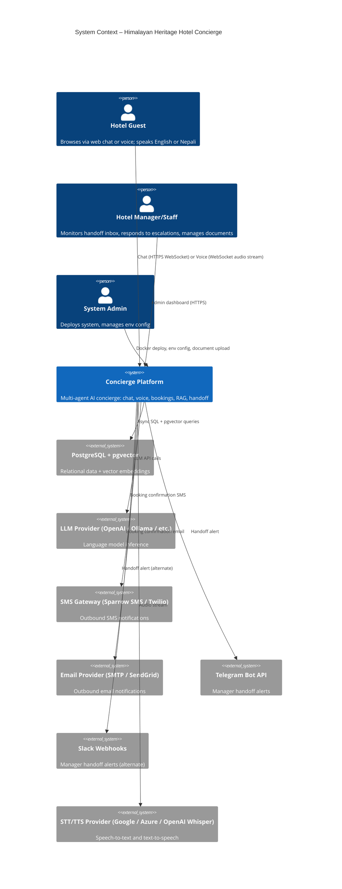
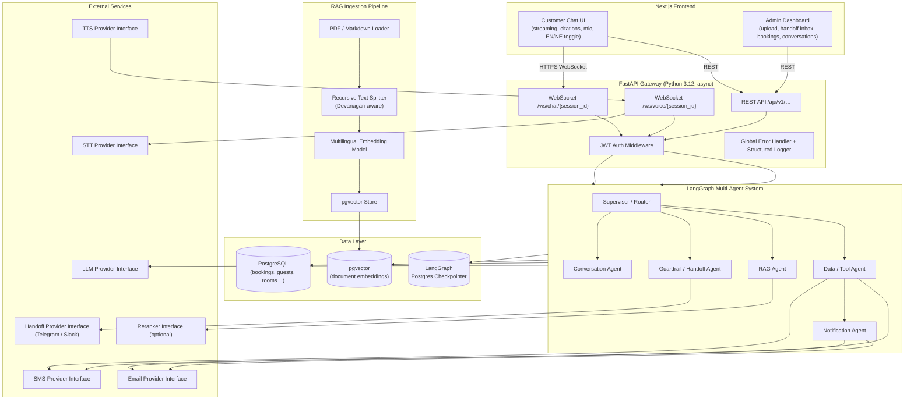
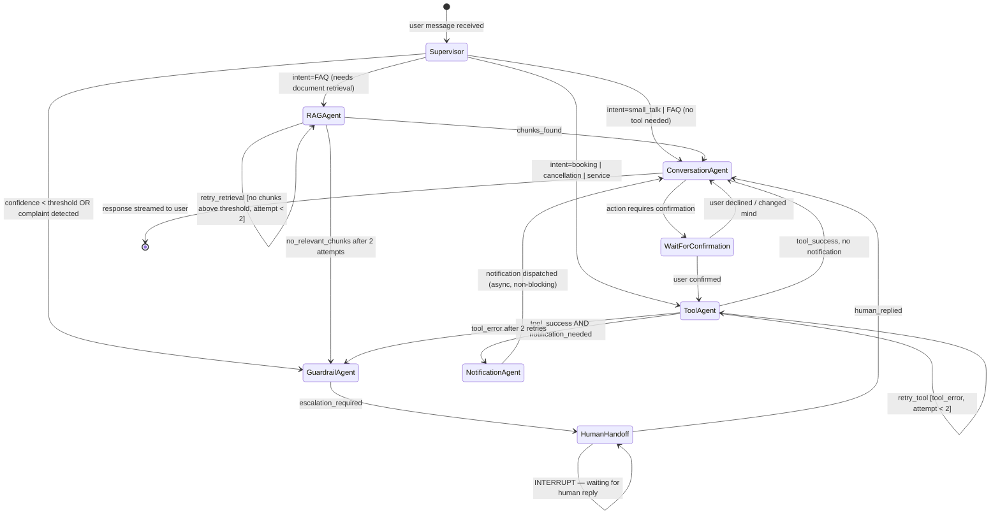
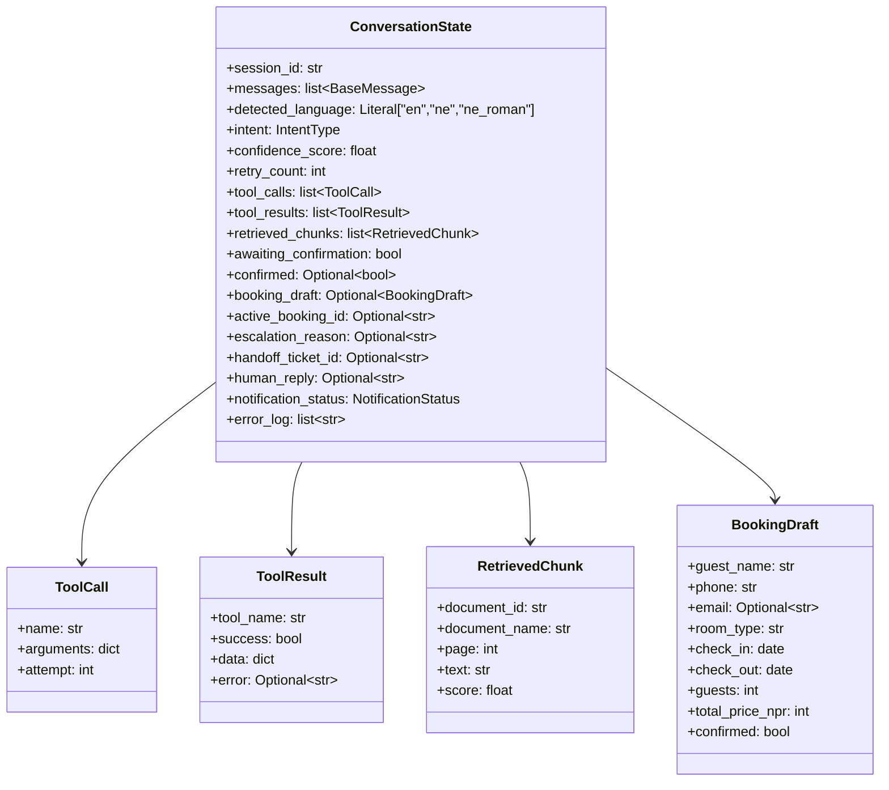
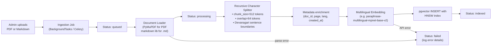
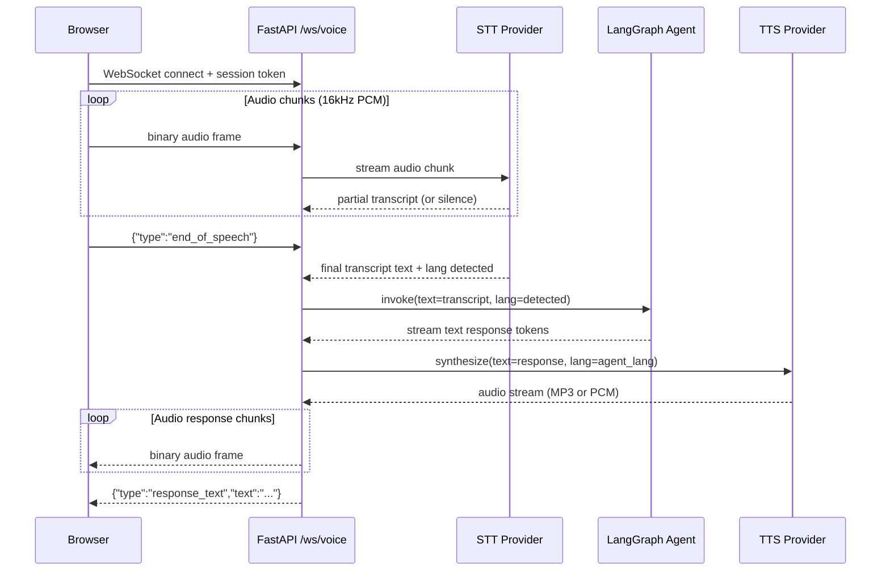
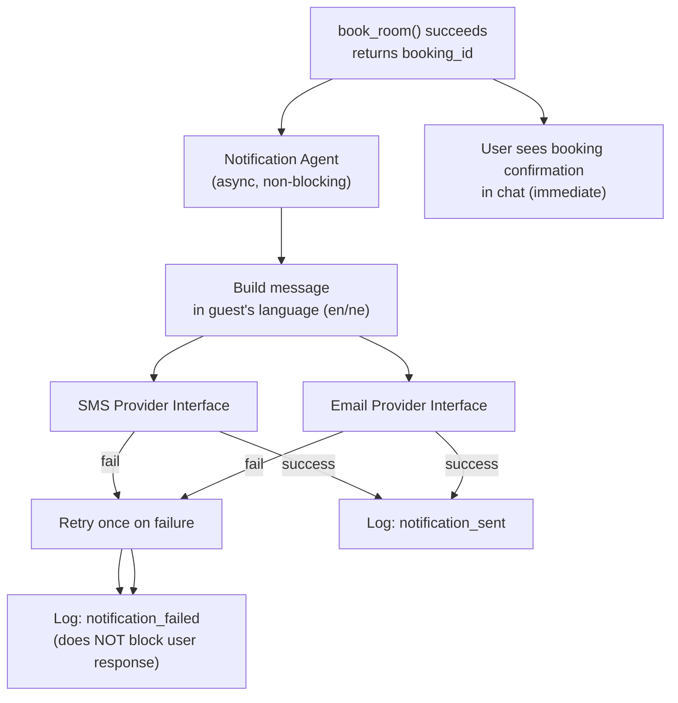
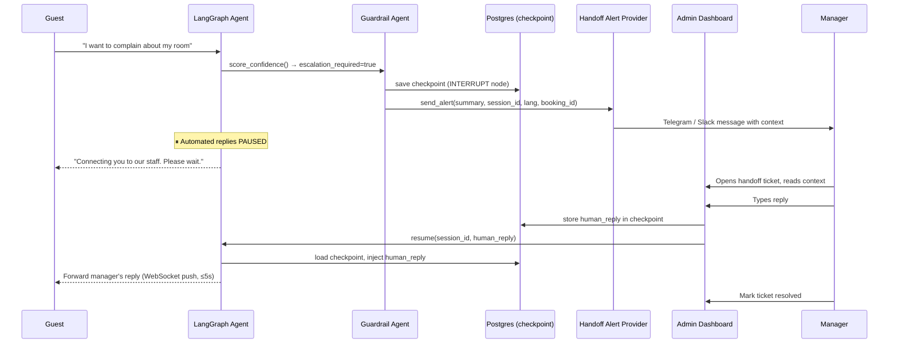
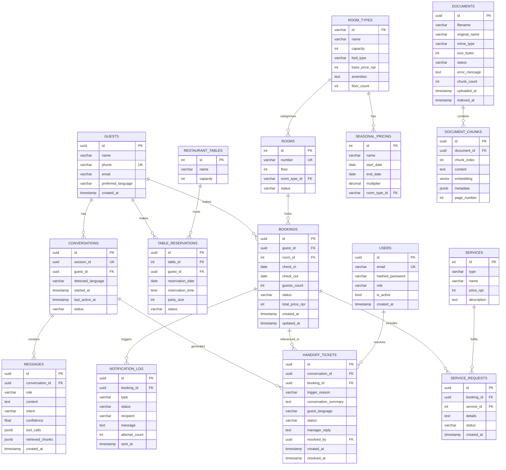
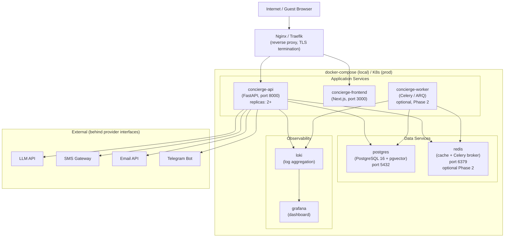

# Architecture Document
## Autonomous Multi-Agent Local Business Concierge
### Demo Instance: Himalayan Heritage Hotel

**Version:** 1.0.0  
**Date:** 2026-10-12

---

## 1. System Context Diagram



---

## 2. High-Level Component Architecture



---

## 3. Request Data-Flow: Chat Message

```mermaid
sequenceDiagram
    participant G as Guest Browser
    participant WS as FastAPI WebSocket
    participant SV as Supervisor Agent
    participant RA as RAG Agent
    participant TA as Tool Agent
    participant DB as PostgreSQL
    participant VDB as pgvector
    participant LLM as LLM Provider
    participant NA as Notification Agent
    participant SMS as SMS Gateway

    G->>WS: {"type":"message","text":"Do you have deluxe room 5-8 Kartik?","lang":"en"}
    WS->>WS: Load or create LangGraph checkpoint (session_id)
    WS->>SV: invoke(state)

    SV->>LLM: Classify intent
    LLM-->>SV: intent=booking_intent, lang=en

    SV->>TA: route(booking_intent)
    TA->>TA: Parse dates, convert BS→Gregorian (if needed)
    TA->>DB: check_room_availability(check_in, check_out, guests, "deluxe")
    DB-->>TA: available_rooms=[{id:14,number:"201",...}]
    TA->>DB: get_room_price("deluxe", check_in, check_out)
    DB-->>TA: {base:4500, multiplier:1.0, total:13500, nights:3}

    TA->>SV: tool_results
    SV->>ConvAgent: draft_response(tool_results, lang=en)
    ConvAgent->>LLM: Generate confirmation prompt (with price, dates)
    LLM-->>ConvAgent: "Yes, I found a Deluxe room available… Total: NPR 13,500. Shall I book it?"

    ConvAgent-->>WS: stream tokens
    WS-->>G: {"type":"stream","delta":"Yes, I found..."}

    Note over G,WS: Guest replies: "Yes, book it for me"

    G->>WS: {"type":"message","text":"Yes, book it","lang":"en"}
    WS->>SV: invoke(state with confirmation=true)
    SV->>TA: book_room(guest_name,phone,room_type,dates)
    TA->>DB: BEGIN TRANSACTION; SELECT … FOR UPDATE; INSERT booking
    DB-->>TA: booking_id="BK-2026-0441"
    TA->>NA: dispatch_notification(booking_id)
    NA->>SMS: send_sms(phone, message_en)
    NA->>EmailProvider: send_email(email, body_en)

    TA-->>WS: booking_confirmed
    WS-->>G: {"type":"booking_confirmed","booking_id":"BK-2026-0441",...}
```

---

## 4. LangGraph State Machine



---

## 5. LangGraph State Schema



---

## 6. RAG Ingestion Pipeline



---

## 7. Voice Streaming Flow



---

## 8. Notification Flow



---

## 9. Human Handoff Flow



---

## 10. Database ER Diagram



---

## 11. Deployment Architecture



---

## 12. Full Folder Structure

```
hotel-concierge/
├── .env.example                        # All required environment variable names with placeholders
├── .env                                # Local secrets (git-ignored)
├── docker-compose.yml                  # Postgres, pgvector, app, frontend, optional Redis
├── Makefile                            # Shortcuts: make dev, make test, make migrate, make seed
├── README.md                           # Quick-start guide
│
├── docs/                               # All documentation (this folder)
│   ├── prd.md
│   ├── architecture.md
│   ├── rules.md
│   ├── design.md
│   ├── tasks.md
│   └── memory.md
│
├── docs/steering/
│       ├── tech-stack.md               # Tech stack and version pins
│       ├── coding-standards.md         # rules.md mirrored for AI coding sessions
│       └── folder-structure.md         # Folder map mirrored for AI coding sessions
│
├── backend/
│   ├── pyproject.toml                  # Project metadata, deps, ruff/mypy config
│   ├── alembic.ini                     # Alembic migration config
│   ├── alembic/
│   │   ├── env.py                      # Async-aware Alembic env
│   │   └── versions/                   # Migration files (auto-generated)
│   │
│   ├── app/
│   │   ├── main.py                     # FastAPI app factory, middleware registration
│   │   ├── config.py                   # Pydantic Settings, reads .env
│   │   ├── dependencies.py             # FastAPI Depends: DB session, current user
│   │   ├── exceptions.py               # Custom exception classes (AppError hierarchy)
│   │   ├── middleware/
│   │   │   ├── logging.py              # Request ID injection, structured JSON logging
│   │   │   ├── error_handler.py        # Global exception → JSON response mapper
│   │   │   └── rate_limit.py           # Sliding-window rate limiter (in-memory or Redis)
│   │   │
│   │   ├── db/
│   │   │   ├── base.py                 # SQLAlchemy async engine, session factory
│   │   │   ├── models/
│   │   │   │   ├── guest.py            # Guest ORM model
│   │   │   │   ├── room.py             # Room + RoomType ORM models
│   │   │   │   ├── booking.py          # Booking ORM model
│   │   │   │   ├── service.py          # Service + ServiceRequest ORM models
│   │   │   │   ├── restaurant.py       # RestaurantTable + TableReservation
│   │   │   │   ├── seasonal_pricing.py # SeasonalPricing ORM model
│   │   │   │   ├── document.py         # Document + DocumentChunk ORM models
│   │   │   │   ├── conversation.py     # Conversation + Message ORM models
│   │   │   │   ├── handoff.py          # HandoffTicket ORM model
│   │   │   │   ├── user.py             # User (admin/staff) ORM model
│   │   │   │   └── notification.py     # NotificationLog ORM model
│   │   │   └── repositories/
│   │   │       ├── booking_repo.py     # Async DB operations for bookings
│   │   │       ├── room_repo.py        # Room availability queries
│   │   │       ├── guest_repo.py       # Guest CRUD
│   │   │       ├── document_repo.py    # Document ingestion status updates
│   │   │       └── handoff_repo.py     # Handoff ticket CRUD
│   │   │
│   │   ├── auth/
│   │   │   ├── jwt.py                  # Token creation, verification, refresh
│   │   │   ├── password.py             # Bcrypt hashing
│   │   │   └── schemas.py              # LoginRequest, TokenResponse Pydantic schemas
│   │   │
│   │   ├── api/
│   │   │   ├── v1/
│   │   │   │   ├── router.py           # Aggregates all v1 routers
│   │   │   │   ├── auth.py             # POST /auth/login, /auth/refresh, /auth/logout
│   │   │   │   ├── documents.py        # POST /documents, GET /documents, DELETE /documents/{id}
│   │   │   │   ├── bookings.py         # GET /bookings (admin), GET /bookings/{id}
│   │   │   │   ├── conversations.py    # GET /conversations, GET /conversations/{id}
│   │   │   │   ├── handoffs.py         # GET /handoffs, POST /handoffs/{id}/reply, PATCH /handoffs/{id}/resolve
│   │   │   │   └── health.py           # GET /health
│   │   │   └── ws/
│   │   │       ├── chat.py             # WebSocket /ws/chat/{session_id}
│   │   │       └── voice.py            # WebSocket /ws/voice/{session_id}
│   │   │
│   │   ├── agents/
│   │   │   ├── state.py                # ConversationState TypedDict + all sub-schemas
│   │   │   ├── graph.py                # LangGraph graph construction, edge definitions
│   │   │   ├── supervisor.py           # Supervisor/Router node
│   │   │   ├── conversation.py         # Conversation Agent node
│   │   │   ├── rag_agent.py            # RAG Agent node (retrieval + draft)
│   │   │   ├── tool_agent.py           # Tool Agent node (validate + call tools)
│   │   │   ├── notification_agent.py   # Notification Agent node
│   │   │   ├── guardrail_agent.py      # Guardrail / Handoff Agent node
│   │   │   └── checkpointer.py         # Postgres checkpointer setup
│   │   │
│   │   ├── tools/
│   │   │   ├── schemas.py              # Pydantic input/output schemas for all tools
│   │   │   ├── room_tools.py           # check_room_availability, get_room_price
│   │   │   ├── booking_tools.py        # book_room, cancel_booking, modify_booking, get_booking_status
│   │   │   ├── restaurant_tools.py     # reserve_restaurant_table
│   │   │   └── service_tools.py        # request_service
│   │   │
│   │   ├── rag/
│   │   │   ├── ingestion.py            # Orchestrates load → split → embed → store
│   │   │   ├── loaders.py              # PDF loader (PyMuPDF), Markdown loader
│   │   │   ├── splitter.py             # Devanagari-aware recursive splitter
│   │   │   ├── embedder.py             # Embedding provider interface + implementations
│   │   │   ├── vector_store.py         # pgvector insert, similarity search
│   │   │   └── retriever.py            # top-k retrieval + optional reranking
│   │   │
│   │   ├── notifications/
│   │   │   ├── base.py                 # Abstract SMSProvider, EmailProvider
│   │   │   ├── mock_sms.py             # Mock SMS (logs to stdout/file)
│   │   │   ├── mock_email.py           # Mock email (logs to stdout/file)
│   │   │   ├── sparrow_sms.py          # Sparrow SMS gateway implementation
│   │   │   └── smtp_email.py           # SMTP email implementation
│   │   │
│   │   ├── handoff/
│   │   │   ├── base.py                 # Abstract HandoffAlertProvider
│   │   │   ├── telegram_provider.py    # Telegram Bot alert implementation
│   │   │   └── slack_provider.py       # Slack Webhook alert implementation
│   │   │
│   │   ├── voice/
│   │   │   ├── base.py                 # Abstract STTProvider, TTSProvider
│   │   │   ├── whisper_stt.py          # OpenAI Whisper STT implementation
│   │   │   ├── google_stt.py           # Google Cloud STT implementation
│   │   │   └── google_tts.py           # Google Cloud TTS implementation
│   │   │
│   │   └── utils/
│   │       ├── bikram_sambat.py        # BS↔Gregorian conversion utility
│   │       ├── language_detection.py   # Detect en / ne / ne_roman
│   │       ├── currency.py             # NPR formatting helpers
│   │       ├── date_utils.py           # Gregorian date parsing, Nepali month names
│   │       └── logger.py               # Structlog / stdlib JSON logger factory
│   │
│   ├── scripts/
│   │   ├── seed_db.py                  # Seeds all tables with realistic Nepal data
│   │   └── generate_sample_docs.py     # Generates sample hotel PDF/Markdown KB docs
│   │
│   └── tests/
│       ├── conftest.py                 # Pytest fixtures: async DB session, test client, mock providers
│       ├── unit/
│       │   ├── test_bikram_sambat.py   # All 12 months, leap years, edge cases
│       │   ├── test_language_detection.py
│       │   ├── test_seasonal_pricing.py
│       │   ├── test_booking_tools.py   # Tool input validation
│       │   └── test_rag_splitter.py    # Devanagari split correctness
│       ├── integration/
│       │   ├── test_booking_flow.py    # Full booking E2E against test DB
│       │   ├── test_rag_retrieval.py   # Ingestion + retrieval pipeline
│       │   ├── test_handoff.py         # Handoff trigger + interrupt + resume
│       │   └── test_auth.py            # JWT login, refresh, protected routes
│       └── eval/
│           ├── golden_qa_en.json       # 20 English Q&A pairs for RAG eval
│           ├── golden_qa_ne.json       # 20 Nepali Q&A pairs for RAG eval
│           └── run_eval.py             # RAGAS evaluation runner
│
├── frontend/
│   ├── package.json
│   ├── tsconfig.json                   # Strict TypeScript
│   ├── tailwind.config.ts
│   ├── next.config.ts
│   ├── public/
│   │   └── fonts/                      # Devanagari-supporting font (Tiro Devanagari)
│   │
│   └── src/
│       ├── app/
│       │   ├── layout.tsx              # Root layout, font loading, global styles
│       │   ├── page.tsx                # Redirects to /chat
│       │   ├── chat/
│       │   │   └── page.tsx            # Customer chat page
│       │   └── admin/
│       │       ├── layout.tsx          # Admin layout with nav sidebar
│       │       ├── page.tsx            # Admin home → redirect to /admin/handoffs
│       │       ├── login/
│       │       │   └── page.tsx        # JWT login form
│       │       ├── documents/
│       │       │   └── page.tsx        # Document upload + status list
│       │       ├── handoffs/
│       │       │   └── page.tsx        # Handoff inbox + reply interface
│       │       ├── bookings/
│       │       │   └── page.tsx        # Bookings list with filters
│       │       └── conversations/
│       │           └── page.tsx        # Conversation history viewer
│       │
│       ├── components/
│       │   ├── chat/
│       │   │   ├── ChatWindow.tsx      # Main chat container, WebSocket manager
│       │   │   ├── MessageList.tsx     # Renders messages with citation badges
│       │   │   ├── MessageBubble.tsx   # Single message (user/assistant/human-agent)
│       │   │   ├── InputBar.tsx        # Text input + mic button + lang toggle
│       │   │   ├── VoiceCapture.tsx    # MediaRecorder, WebAudio, PCM streaming
│       │   │   ├── CitationBadge.tsx   # Inline source citation pill
│       │   │   └── HumanHandoffBanner.tsx  # "Connected to staff" status bar
│       │   ├── admin/
│       │   │   ├── DocumentUpload.tsx  # Drag-drop upload with progress bar
│       │   │   ├── DocumentList.tsx    # Table of docs with status badges
│       │   │   ├── HandoffTicket.tsx   # Single ticket card with reply form
│       │   │   ├── BookingTable.tsx    # Filterable bookings data grid
│       │   │   └── ConversationViewer.tsx  # Message-by-message conversation viewer
│       │   └── shared/
│       │       ├── Navbar.tsx
│       │       ├── Sidebar.tsx
│       │       ├── StatusBadge.tsx     # Reusable color-coded status badge
│       │       ├── LoadingSpinner.tsx
│       │       └── ErrorBoundary.tsx
│       │
│       ├── hooks/
│       │   ├── useWebSocket.ts         # Generic WebSocket hook with reconnect logic
│       │   ├── useVoice.ts             # MediaRecorder lifecycle, PCM chunking
│       │   ├── useChat.ts              # Chat state, message list, streaming buffer
│       │   └── useAuth.ts             # JWT login, refresh, logout, role guard
│       │
│       ├── lib/
│       │   ├── api.ts                  # Typed fetch wrapper for backend REST API
│       │   ├── ws-protocol.ts          # TypeScript types for WebSocket message protocol
│       │   └── i18n.ts                 # en/ne string maps, language switcher helper
│       │
│       └── types/
│           ├── chat.ts                 # ChatMessage, Citation, HandoffState types
│           ├── booking.ts              # Booking, RoomType, Guest types
│           └── admin.ts                # Document, HandoffTicket, User types
│
└── knowledge_base/
    ├── en/
    │   ├── hotel_policies.md           # Check-in/out, cancellation, ID, child/pet policy
    │   ├── room_descriptions.md        # All room types with amenities
    │   ├── restaurant_menu.md          # Full menu with NPR prices
    │   ├── nearby_attractions.md       # Directions to Koshi Tappu, Dharan, etc.
    │   ├── transfer_info.md            # Airport/bus-park pickup info
    │   ├── festival_packages.md        # Dashain/Tihar/Chhath packages
    │   ├── payment_methods.md          # Cash, eSewa, Khalti, bank transfer
    │   └── faq.md                      # Frequently asked questions
    └── ne/
        ├── hotel_policies_ne.md        # Same content in Nepali (Devanagari)
        ├── room_descriptions_ne.md
        ├── restaurant_menu_ne.md
        └── faq_ne.md
```
